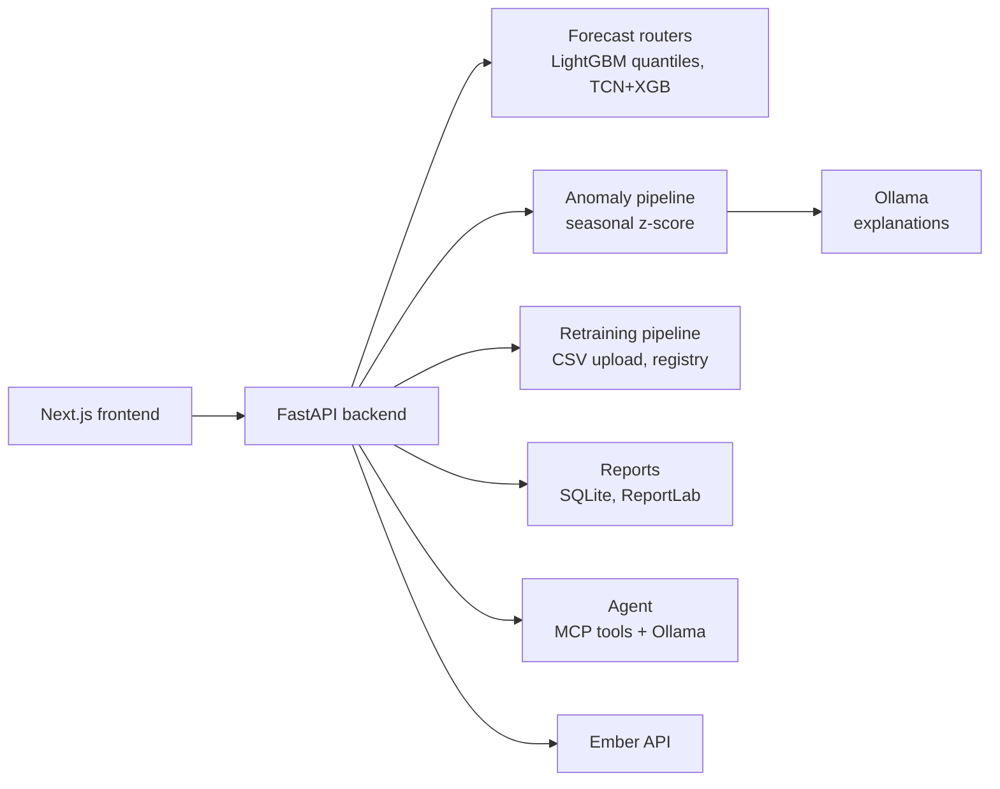

# Prometheus

An operations console for grid officers: hourly electricity-demand forecasts with uncertainty bands,
anomaly alerts with plain-language explanations, a retraining flow for new data, and an LLM agent that
can query the forecast and propose actions.

**Winner of the Adani Powermind Hackathon 2026**, built by a team of five. Maintained by
[Purv Kabaria](https://github.com/Purv-Kabaria).


---

## Who built what

| Area | Owner |
|---|---|
| LightGBM forecaster, data cleaning, exploratory analysis, leak-free evaluation | Purv Kabaria |
| LLM explanations for detected anomalies (Ollama), anomaly console | Purv Kabaria |
| TCN + XGBoost submission model, XGBoost / CatBoost experiments | Teammates |
| Dashboard, simulation, reporting, Ember market data, MCP agent | Teammates |

Commit history has the details (`git log --author`).

## How accurate is the forecast?

The question that matters for a day-ahead forecast is: **using only data available a day before, how
close is the prediction?** [`backend/scripts/evaluate_day_ahead.py`](backend/scripts/evaluate_day_ahead.py)
answers it on the hackathon's six years of hourly demand data:

| Model (test year 2021, read once) | MAPE |
|---|---|
| **LightGBM, 24 hours ahead** | **2.59%** |
| Naive: same hour yesterday | 3.73% |
| Naive: same hour last week | 5.75% |

- Train 2016–2019, choose the number of trees on 2020, refit on 2016–2020, test on 2021 once.
- Every feature is at least 24 hours old at prediction time (lags of 24, 48, 72, 168 and 336 hours,
  rolling statistics ending a day earlier, calendar features).
- Validation (2020) also scores 2.59%, so the model is not overfitting the tuning year.
- About 30% less error than the best naive forecast.

**About the older numbers.** The hackathon notebook reported 0.65% MAPE. Its features included the
actual demand one hour earlier, and its walk-forward check supplied that true value for every hour of a
24-hour window, so it measured one-hour-ahead accuracy. The same LightGBM, allowed one-hour-old data,
scores 0.66%, which reproduces it. The TCN + XGBoost submission's "1.54%" also uses the previous hour's
demand and is not reproduced by any script here, so the app labels it "not re-evaluated". Full write-up:
[`backend/analysis/DAY_AHEAD_EVALUATION.md`](backend/analysis/DAY_AHEAD_EVALUATION.md), and the story behind it
[on the blog](https://purvkabaria.netlify.app/blog/adani-powermind-hackathon-energy-forecasting).

## What the app does

| Page | What it shows | How it works |
|---|---|---|
| `/` Grid control | Demand vs committed generation, reserve margin, agent proposals | Reads the forecast and the SQLite prediction store |
| `/forecasting` | 24h, 7-day and 30-day forecasts with P10/P50/P90 bands, peak and off-peak windows | LightGBM quantile models (one per quantile) when loaded, otherwise a labelled synthetic profile |
| Explainability panel | Which features drove a forecast | Real SHAP `TreeExplainer` on the LightGBM P50 model when it is loaded; marked "simulated" when it is not |
| `/insights` | Day-ahead accuracy vs baselines and feature importance | Values from the leak-free evaluation above |
| `/anomaly` | Spikes and dips in demand, with explanations | Seasonal z-score per hour of day; each event explained in plain language by a local LLM (Ollama) |
| `/upload` | Upload new hourly data and retrain | CSV validation (timestamp continuity), background retraining job, versioned model registry |
| `/agent` | Chat with an agent that proposes grid actions | Ollama model calling MCP tools: forecast lookup, equipment status, maintenance windows, market data |
| `/simulation` | Generation mix and equipment health | Simulated demo data, not live telemetry |
| `/reporting` | Historical reports and PDF export | ReportLab PDFs from the SQLite store |
| `/ember` | Electricity market data | Ember Energy API |

## Architecture



## Running it

```bash
docker compose up --build        # frontend :3000, backend :8000, Ollama :11434 (pulls qwen2.5:3b)
```

Or locally:

```bash
cd backend && python -m venv venv && source venv/bin/activate
pip install -r requirements.txt && python main.py           # http://localhost:8000
cd frontend && npm install && npm run dev                   # http://localhost:3000
```

Optional `.env` at the root: `OLLAMA_HOST`, `OLLAMA_MODEL` (default `qwen2.5:3b`), `EMBER_API`,
`NEXT_PUBLIC_API_URL` (default `http://127.0.0.1:8000`).

Reproduce the evaluation:

```bash
cd backend && pip install lightgbm pandas openpyxl && python scripts/evaluate_day_ahead.py
```

## Known limitations

- The deployed LightGBM quantile models were trained during the hackathon; the 2.59% figure comes from a
  point model with the same feature recipe, retrained under the leak-free rules. Retraining the quantile
  models with the same rules is the obvious next step.
- No weather forecast is used. Day-ahead demand depends on temperature, and a real deployment would add
  forecast (not observed) weather as a feature.
- The simulation page and parts of the dashboard run on generated demo data, not live grid telemetry.
- The agent's proposals are suggestions for an officer to approve, not automated actions.

## Repository layout

```
backend/
  main.py                 FastAPI app (routers/ holds every endpoint)
  routers/                forecast, anomalies, pipeline, live, performance, reports, history, ember
  scripts/                evaluate_day_ahead.py, retraining and seeding helpers
  analysis/               evaluation results and write-up
  anomaly_pipeline.py     seasonal z-score detection + LLM explanations
  agent_client.py         Ollama agent loop; mcp_server.py exposes its tools
  notebooks/              hackathon research notebooks (see the note on their numbers above)
frontend/                 Next.js app (src/app/<page>)
```
