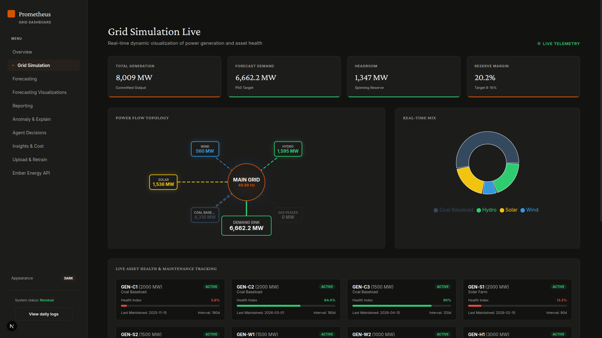
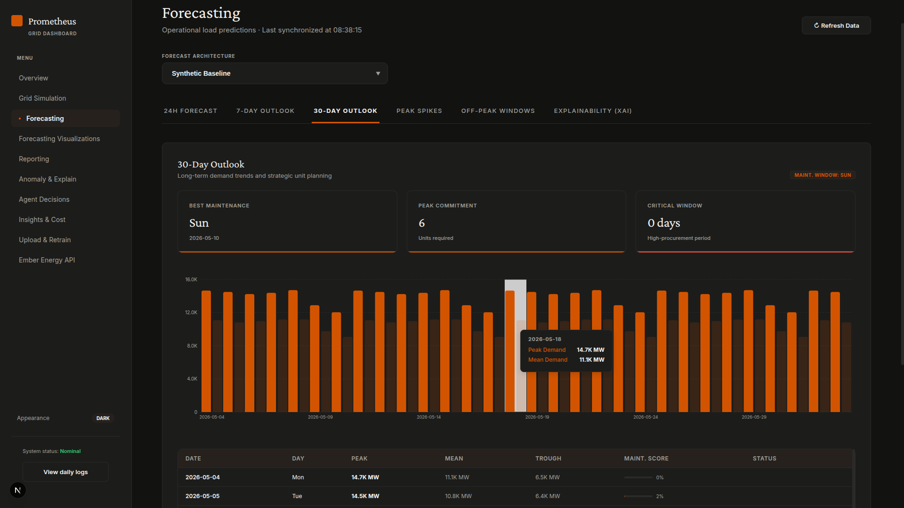
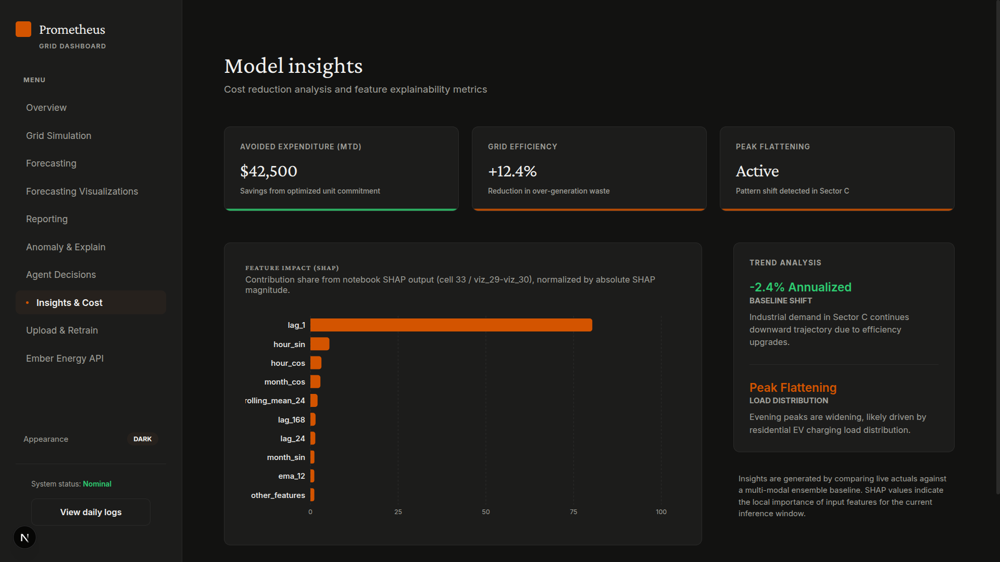
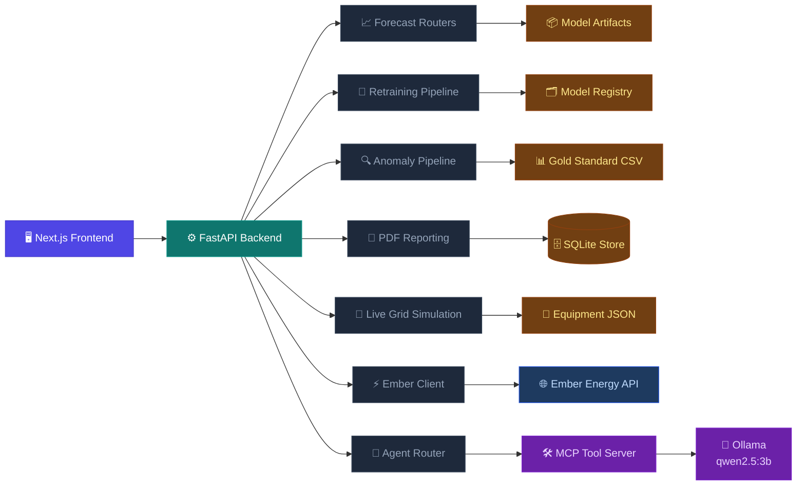

# Prometheus Grid Intelligence Platform

> An end-to-end operational intelligence layer for grid officers and energy analysts, covering demand forecasting, anomaly detection, generation simulation, model retraining, and agent-assisted decision support.

<br/>

[]()
[]()
[]()
[]()
[]()
[]()
[]()
[]()
[]()
[]()
[]()
[]()
[]()
[]()

---

## Team and evaluation

Team project that **won the Adani Powermind Hackathon 2026**. Purv Kabaria built the LightGBM forecaster, the data preparation and the LLM anomaly explanations; teammates built the dashboard, the TCN model, the agent and the simulation.

**Honest accuracy:** the LightGBM model forecasts **24 hours ahead at 2.59% MAPE** on held-out 2021 (3.73% for "same hour yesterday"), with every feature at least a day old. Earlier figures (0.65%, the TCN's 1.54%) used the previous hour's demand as an input, so they measure one-hour-ahead accuracy. Details and the script: [backend/analysis/DAY_AHEAD_EVALUATION.md](backend/analysis/DAY_AHEAD_EVALUATION.md).

## 📸 Platform Preview

### Grid Control


### Forecasting Console


### Model Insights


---

## Table of Contents

- [Overview](#overview)
- [Core Capabilities](#core-capabilities)
- [Architecture](#architecture)
- [Repository Structure](#repository-structure)
- [Technology Stack](#technology-stack)
- [Getting Started](#getting-started)
- [Configuration](#configuration)
- [Application Modules](#application-modules)
- [Backend API Surface](#backend-api-surface)
- [Modeling and Data Pipeline](#modeling-and-data-pipeline)
- [Data and Model Artifacts](#data-and-model-artifacts)
- [Agent Workflow](#agent-workflow)
- [Reports and Artifacts](#reports-and-artifacts)
- [Development Commands](#development-commands)
- [Troubleshooting](#troubleshooting)
- [License](#license)

---

## Overview

Prometheus is built as an operational intelligence layer for grid officers and energy analysts. The platform surfaces live generation and demand telemetry, predicts short and medium-term load, identifies anomalous consumption behavior, recommends maintenance or curtailment actions, and produces PDF reports for institutional review.

The system is organized around four practical operating loops:

**Forecast** — Demand prediction across 24-hour, 7-day, and 30-day horizons with P10, P50, and P90 quantile bands.

**Compare** — Committed generation benchmarked against expected demand and reserve margin targets in real time.

**Detect** — Spike and dip anomaly detection using a seasonal z-score pipeline, with LLM-powered natural language explanations per event.

**Retrain** — Ingest new telemetry, trigger background retraining jobs, and track versioned model state through the registry.

---

## ⚡ Core Capabilities

- Real-time grid control dashboard showing demand, generation, reserve margin, frequency, and active agent proposals
- Multi-model forecasting console with full P10, P50, and P90 prediction bands
- 7-day and 30-day planning views for procurement pressure, unit commitment, and maintenance windows
- Peak spike detection and off-peak window discovery for storage, curtailment, and low-risk operations
- Explainability panel: real SHAP (TreeExplainer) on the LightGBM P50 model when it is loaded, clearly labelled as simulated when it is not
- Anomaly analysis console with residual baseline charts, event logs, acknowledgement flows, and LLM explanations
- Live grid simulation covering generation mix, power-flow topology, and equipment health tracking
- Agent decision page backed by MCP tools and Ollama for grid-specific decision support
- CSV ingestion pipeline with timestamp continuity validation, anomaly scan, background retraining, and registry updates
- Historical reporting dashboard with financial, operational, carbon credit, and PDF archive views
- Ember Energy market client for electricity price and market data workflows

---

## 🏗 Architecture



---

## 📁 Repository Structure

```
.
+-- backend/
|   +-- main.py                         # FastAPI entrypoint
|   +-- routers/
|   |   +-- agent.py                    # Agent trigger, status, proposals, feedback
|   |   +-- anomalies.py                # Anomaly list, alerts, explanations, chat
|   |   +-- ember.py                    # Ember energy market endpoints
|   |   +-- forecast.py                 # Forecast products and XAI endpoint
|   |   +-- history.py                  # Historical actual vs predicted data
|   |   +-- live.py                     # Live telemetry and generation simulation
|   |   +-- performance.py              # Model performance metrics
|   |   +-- pipeline.py                 # CSV upload, retrain jobs, registry
|   |   +-- reports.py                  # PDF report generation and archive
|   +-- services/                       # Shared backend services
|   +-- scripts/                        # Retraining, data prep, and seeding helpers
|   +-- models/                         # Forecasting and retraining model artifacts
|   +-- data/                           # Operational data, anomaly log, SQLite stores
|   +-- notebooks/                      # Research and model development notebooks
|   +-- anomaly_pipeline.py             # Seasonal z-score anomaly pipeline
|   +-- agent_client.py                 # Ollama + MCP agent loop
|   +-- mcp_server.py                   # MCP tools for grid operations
|   +-- requirements.txt
|
+-- frontend/
|   +-- src/app/                        # Next.js app routes
|   +-- src/components/                 # Shared UI components
|   +-- src/hooks/                      # Client-side rendering helpers
|   +-- src/lib/                        # Frontend API helpers
|   +-- public/images/                  # README and platform screenshots
|
+-- models/                             # Root model registry mirror
+-- docker-compose.yml
+-- README.md
```

---

## 🛠 Technology Stack

| Layer | Tools |
|---|---|
| Frontend | Next.js 16, React 19, Recharts, Tailwind/PostCSS, lucide-react |
| Backend API | FastAPI, Uvicorn, Pydantic, CORS middleware |
| Data Science | NumPy, Pandas, SciPy, scikit-learn, statsmodels, sktime, Darts |
| Forecasting Models | LightGBM quantile models, XGBoost, CatBoost, Prophet, TCN/PyTorch |
| Agent Runtime | Ollama, MCP, LangChain — default model: `qwen2.5:3b` |
| Persistence | SQLite, JSON registry files, CSV gold-standard store |
| Reporting | ReportLab PDF generation |
| Deployment | Docker, Docker Compose |

---

## 🚀 Getting Started

### Prerequisites

- Python 3.10 or newer
- Node.js 20 or newer with npm
- Docker and Docker Compose (optional, recommended for full-stack startup)
- Ollama — required for the agent and LLM-assisted anomaly explanation workflows

### Option A: Docker Compose

```bash
docker compose up --build
```

This starts three services:

| Service | URL |
|---|---|
| Frontend | `http://localhost:3000` |
| Backend API | `http://localhost:8000` |
| Ollama | `http://localhost:11434` |

The Ollama container automatically pulls `qwen2.5:3b` on first start.

### Option B: Local Development

Start the backend:

```bash
cd backend
python3 -m venv venv
source venv/bin/activate
pip install -r requirements.txt
python3 main.py
```

Start the frontend in a second terminal:

```bash
cd frontend
npm install
npm run dev
```

Open the platform at `http://localhost:3000`.

---

## ⚙️ Configuration

Create a `.env` file at the project root:

```env
OLLAMA_HOST=http://localhost:11434
OLLAMA_MODEL=qwen2.5:3b
EMBER_API=your_ember_api_key
NEXT_PUBLIC_API_URL=http://127.0.0.1:8000
```

> **Note:** Several frontend pages call `localhost:8000` or `127.0.0.1:8000` directly, so local development expects the backend on port `8000`. The `NEXT_PUBLIC_API_URL` variable is consumed by shared frontend API helpers and the anomaly alert bar.

---

## 🗂 Application Modules

| Route | Purpose |
|---|---|
| `/` | Grid control dashboard with telemetry, strategic proposals, system health, and agent scan controls |
| `/simulation` | Live generation mix, power-flow topology, reserve margin, and equipment health |
| `/forecasting` | 24-hour, 7-day, 30-day, peak spike, off-peak, and XAI forecast views |
| `/forecasting-visuals` | Collapsible notebook visualization gallery for model diagnostics |
| `/reporting` | Historical operational intelligence, financial indicators, and generated PDF reports |
| `/anomaly` | Anomaly detection console, event review, LLM explanation, chat, and acknowledgement |
| `/agent` | Prometheus agent chat, proposal queue, and officer feedback workflow |
| `/insights` | Day-ahead accuracy vs naive baselines and feature importance, from the leak-free evaluation |
| `/upload` | CSV ingestion, retraining job monitoring, and model registry view |
| `/ember` | Ember Energy market data and pricing workflow |

---

## 🔌 Backend API Surface

### Forecasting

```
GET  /api/forecast/models
GET  /api/forecast/24h
GET  /api/forecast/7day
GET  /api/forecast/30day
GET  /api/forecast/peak-hours
GET  /api/forecast/offpeak
GET  /api/forecast/explain
```

### Live Grid

```
GET  /api/live-comparison
GET  /api/live-comparison/generation
GET  /api/live-comparison/equipment
```

### Anomalies

```
GET  /api/anomalies/list
GET  /api/anomalies/alerts/active
GET  /api/anomalies/series
POST /api/anomalies/{anomaly_id}/ack
POST /api/anomalies/{anomaly_id}/explain
POST /api/anomalies/{anomaly_id}/chat
POST /api/anomalies/rescan-tail
```

### Agent

```
POST /api/agent/trigger
GET  /api/agent/status/{job_id}
GET  /api/agent/proposals
POST /api/agent/feedback
```

### Pipeline

```
POST /pipeline/upload
GET  /pipeline/status/{job_id}
GET  /pipeline/jobs
GET  /pipeline/registry
GET  /pipeline/registry/{version}
PUT  /pipeline/registry/activate
```

### Reports

```
GET  /api/reports
GET  /api/reports/today-summary
GET  /api/reports/{report_id}/download
POST /api/reports/generate
```

### History and Performance

```
GET  /api/grid-history
GET  /api/model/performance
GET  /api/model/performance/trend
```

### Ember

```
GET  /api/ember/live
GET  /api/ember/hourly
GET  /api/ember/bulk-historical
```

---

## 🧠 Modeling and Data Pipeline

Prometheus supports multiple forecasting modes behind a unified inference interface:

| Mode | Description |
|---|---|
| `synthetic` | Deterministic fallback profile, always available |
| `lgbm` | LightGBM quantile models for P10, P50, and P90 |
| `tcn_xgb` | TCN base model with XGBoost residual correction |
| `adani_*` | CatBoost, LightGBM, Prophet, XGBoost, stacking, voting, and tuned ensemble artifacts |

The retraining pipeline accepts CSV uploads, validates required columns, enforces hourly timestamp continuity, merges clean data into the gold-standard dataset, runs post-ingest anomaly detection, and starts a background retraining job. New model versions are tracked in `backend/models/registry.json`.

**Required ingestion columns:**

```
Start time UTC
End time UTC
Electricity consumption (MWh)
```

---

## 📦 Data and Model Artifacts

| Path | Contents |
|---|---|
| `backend/Adani_Datasets/` | Hourly, daily, weekly, monthly, and yearly consumption datasets |
| `backend/data/gold_standard.csv` | Canonical training and anomaly-detection store used by ingestion workflows |
| `backend/data/anomalies_log.json` | Persisted anomaly events with acknowledgement and explanation state |
| `backend/data/equipment.json` | Simulated equipment registry for live derating, maintenance, and agent tools |
| `backend/data/iced-niti/` | Yearly public energy data extracts |
| `backend/data/open-meteo/` | Weather data extracts used during modeling and feature work |
| `backend/models/` | LightGBM, TCN, XGBoost, Mamba, scaler, metadata, and registry artifacts |
| `frontend/public/forecasting-models/` | Exported notebook visuals used by the forecasting visualization route |

---

## 🤖 Agent Workflow

The Prometheus agent is scoped to grid operations. It uses an MCP tool server to fetch demand forecasts, inspect committed generation, read equipment status, find maintenance windows, and schedule operational proposals. Ollama provides the local LLM runtime, and the backend exposes asynchronous job polling so long-running agent analysis does not block the API server.

```
1.  Officer submits a prompt via Grid Control or the Agent page
2.  Backend starts an agent job and returns a job_id
3.  Frontend polls  GET /api/agent/status/{job_id}
4.  Agent calls MCP tools for forecasts, generation state, and equipment health
5.  Agent writes proposals to SQLite
6.  Officer accepts, rejects, or overrides the proposal
```

---

## 📄 Reports and Artifacts

The reporting module generates PDF reports containing:

- Forecast model performance comparison
- Anomaly summaries
- Operational insights
- Financial indicators: realized revenue, EBITDA, availability, and carbon credit potential
- Institutional benchmark tables

Generated reports are stored under `backend/data/reports/` and served through `GET /api/reports/{report_id}/download`.

---

## 💻 Development Commands

**Frontend**

```bash
cd frontend
npm run dev      # Start development server
npm run build    # Production build
npm run lint     # Lint source files
npm start        # Start production server
```

**Backend**

```bash
cd backend
python3 main.py                                  # Start with defaults
uvicorn main:app --host 0.0.0.0 --port 8000      # Explicit uvicorn start
python3 test_ollama.py                           # Verify Ollama connectivity
python3 test_mcp.py                              # Verify MCP tool server
```

**Docker**

```bash
docker compose up --build    # Build and start all services
docker compose down          # Stop and remove containers
```

---

## 🔧 Troubleshooting

### Frontend cannot reach the backend

Confirm the FastAPI server is running on port `8000`. Most pages are hardcoded to `localhost:8000` for local development.

```bash
curl http://localhost:8000/api/forecast/models
```

### Agent returns Ollama errors

Confirm Ollama is running and the required model has been pulled:

```bash
ollama serve
ollama pull qwen2.5:3b
cd backend && python3 test_ollama.py
```

### Forecast falls back to synthetic mode

The inference layer intentionally falls back to a deterministic profile when a model artifact cannot be loaded. Check the registry endpoint and backend logs:

```bash
curl http://localhost:8000/api/forecast/models
```

### CSV upload fails validation

Uploads must contain the three required columns and continuous hourly timestamps. Gaps, overlaps, and malformed timestamps are rejected before retraining starts. Review the pipeline job log at `GET /pipeline/status/{job_id}` for a detailed failure reason.

---

## 📝 License

No license file is currently included in this repository. Add a project license before distributing, publishing, or using the code outside the intended team or evaluation context.