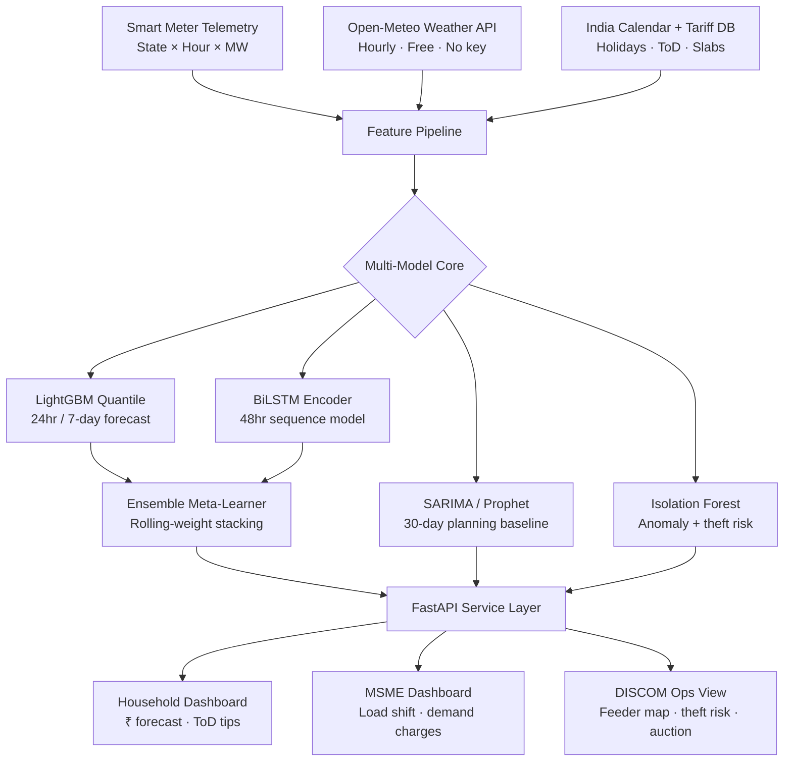

<div align="center">

# ⚡ Prometheus

**India's open-source energy intelligence platform.**
Transforms raw meter telemetry into decisions — forecasting demand, detecting theft,
optimising tariffs, and mapping grid carbon — at every scale from household to feeder.

<br/>

[](/)
[](/)
[](/)
[](/)
[](/)
[](/)
[](LICENSE)

<br/>

| 📊 5.28 Cr | 📉 < 25% | 💸 ₹1.32L Cr | 🗓️ 8 Years |
|:---:|:---:|:---:|:---:|
| Smart meters installed under RDSS (Dec 2025) | DISCOM smart meter data actually utilised | Annual electricity theft loss — the gap we fill | Hourly state-wise demand dataset (2017–2025) |

</div>

---

## Table of Contents

1. [Why Prometheus](#-why-prometheus)
2. [Problem Statement](#-problem-statement)
3. [Dataset](#-dataset)
4. [Model Portfolio](#-model-portfolio)
5. [Feature Tiers](#-feature-tiers)
6. [Architecture](#-architecture)
7. [Technology Stack](#-technology-stack)
8. [Data Sources](#-data-sources)
9. [Getting Started](#-getting-started)
10. [Evaluation Metrics](#-evaluation-metrics)
11. [Roadmap](#-roadmap)
12. [References](#-references)
13. [License](#-license)

---

## 🔥 Why Prometheus

India has deployed **5.28 crore smart meters at a cost of ₹3 lakh crore** under the Revamped Distribution Sector Scheme (RDSS). Yet fewer than one in four DISCOMs meaningfully utilise the data these meters generate. The Ministry of Power has explicitly mandated that AI/ML be deployed to detect theft and build actionable intelligence from smart meter data. **Prometheus is that analytics layer.**

Beyond theft, the June 2023 ToD (Time-of-Day) tariff rules — now live for all non-agricultural consumers — create a **40% intra-day price spread** between solar hours (10 AM–6 PM) and peak hours (6 PM–10 PM). No consumer-facing tool translates this into rupee-level decisions. Prometheus does.

> **Context:** AT&C losses fell to a record **15.04%** in FY2024-25, yet remain more than double the global average of ~7% (IEA, 2021). Prometheus targets the commercial loss component — the part driven by undetected theft, poor demand forecasting, and suboptimal load scheduling.

---

## 📋 Problem Statement

This hackathon provides **six years of hourly electricity consumption data** (we have eight, 2017–2025) representing a multivariate time series with clear daily, weekly, and yearly seasonality, as well as state-level heterogeneity, festival spikes, and weather-driven demand shifts.

> **The challenge:** Design and implement ML/DL solutions that capture temporal dependencies, seasonality, and trends; handle missing values, noise, and unexpected fluctuations; deliver accurate predictions; *and* provide interpretability and actionable insights — not just a loss metric.

### What participants must deliver

1. Explore and understand the dataset — identify patterns, trends, and anomalies
2. Preprocess data including missing value imputation and outlier handling
3. Engineer relevant features (time-based, weather-based, India-specific calendar features)
4. Select and justify forecasting model(s) with architecture rationale
5. Train and validate on historical data with temporal cross-validation
6. Evaluate using MAE, RMSE, and MAPE
7. Present insights and explain model behavior (SHAP, partial dependence)

### Expected outputs

- Working forecasting model(s) predicting hourly energy demand
- Visual comparison of actual vs predicted values (by state, by season)
- Performance metrics table across all models
- Insights into consumption trends and model behavior

### Suggested approaches (from problem statement)

> Participants may explore models such as **ARIMA, SARIMA, Prophet, LSTM,** or tree-based methods like **XGBoost**. Python libraries such as Pandas, NumPy, scikit-learn, TensorFlow, and PyTorch can be used. Visualization tools like Matplotlib or Power BI are recommended for presenting results.

Prometheus implements all of the above — and goes further with a multi-model ensemble, quantile uncertainty, and operational decision layers.

---

## 📦 Dataset

### Primary training dataset

State-wise hourly electricity demand for all Indian states and union territories, spanning **January 2017 – December 2025** (~70,000 rows per state, ~2.5M rows total).

| Column | Type | Description | Notes |
|--------|------|-------------|-------|
| `State` | Categorical | Indian state or UT name | 36 unique values; add region grouping as a feature |
| `Date` | Date | Calendar date (YYYY-MM-DD) | Parse with timezone = IST (UTC+5:30) |
| `Hour` | Integer 0–23 | Hour of day | Combine with Date → single datetime index |
| `Hourly Demand Met (in MW)` | Float | **Target variable** — actual demand served in MW | May contain zeros/nulls during outages; treat carefully |

### Weather enrichment (Open-Meteo)

Open-Meteo provides hourly historical weather for every Indian state capital (1979–present, free, no API key). The full variable set is large — we select based on energy relevance:

| Variable | Unit | Energy Relevance | Include? |
|----------|------|-----------------|----------|
| `temperature_2m` | °C | AC/heating load driver — strongest single predictor in summer | ✅ Primary |
| `apparent_temperature` | °C | Perceived heat (heat index) — often better than dry-bulb for AC | ✅ Primary |
| `relative_humidity_2m` | % | Humidity amplifies cooling load; affects evaporative cooler usage | ✅ Primary |
| `dewpoint_2m` | °C | Correlated with humidity; use one or the other to avoid collinearity | ⚠️ Optional |
| `shortwave_radiation` | W/m² | Drives solar generation offset; key for rooftop solar states | ✅ Primary |
| `direct_normal_irradiance` | W/m² | More precise solar for panel efficiency calculation | ⚠️ Optional |
| `wind_speed_10m` | km/h | Drives wind generation in Rajasthan, Gujarat, TN, AP | ✅ Primary |
| `cloud_cover` | % | Correlated with solar irradiance and cooling load | ⚠️ Optional |
| `precipitation` | mm | Monsoon drives sharp load drops (cooler, irrigation pumps off) | ✅ Primary |
| `soil_moisture_0_1cm` | m³/m³ | Proxy for agricultural pump load in agri-heavy states | ✅ Selected states |
| `et0_fao_evapotranspiration` | mm | Agricultural water stress — drives pump load in Punjab, Haryana, UP | ✅ Selected states |
| `vapour_pressure_deficit` | kPa | Heat stress index; correlated with cooling demand | ❌ Skip (use `apparent_temperature`) |
| `surface_pressure` | hPa | Minimal direct impact on residential load | ❌ Skip |
| `carbon_monoxide / nitrogen_dioxide` | μg/m³ | AQI proxies — no direct demand link | ❌ Skip |

> **Feature engineering tip:** Create `cooling_degree_hours = max(T − 18, 0)` and `heating_degree_hours = max(18 − T, 0)`. These are more directly correlated with AC/heater load than raw temperature.

### India-specific engineered features

| Feature | How to Build | Why It Matters |
|---------|-------------|----------------|
| `is_holiday` | India `holidays` Python lib — national + state level | Diwali, Holi, Eid drive ±30% demand swings |
| `days_to_holiday` | Signed distance to nearest holiday | Pre-holiday commercial surge; post-holiday drop |
| `is_ipl_match_day` | Join IPL fixture data (2017–2025, public) | Evening TV + AC load spike in match cities |
| `monsoon_phase` | Encode pre/active/post per state using IMD onset dates | Monsoon drops load 8–15% in most states |
| `agricultural_season` | Rabi/Kharif crop calendar by state | Irrigation pump load dominates rural feeders |
| `tod_window` | Encode: solar (10–18h) / peak (18–22h) / off-peak | Post-ToD tariff regime behavioral signal |
| `slab_proximity` | Monthly cumulative kWh vs. slab thresholds | Consumers near slab boundaries shift behavior |
| `lag_1h / lag_24h / lag_168h` | Shift target column | Hourly autocorrelation is extremely high |
| `rolling_mean_24h / 168h` | Rolling window on demand | Smooth seasonal baseline |
| `region` | Map state → North/South/East/West/NE/Central | Regional grid interconnection clusters |
| `cooling_degree_hours` | `max(temperature_2m − 18, 0)` | Direct AC load proxy |

---

## 🧠 Model Portfolio

We build **multiple specialised models** for distinct use cases — not a single monolithic predictor. Each model is justified by peer-reviewed research and serves a specific operational stakeholder.

---

### Model 01 — LightGBM Quantile Ensemble
**Horizon:** 24 hr & 7 day · **Stakeholder:** DISCOM operators, households

The primary forecaster for operational dispatch planning and consumer bill intelligence.

- Trained with `objective='quantile'` at `alpha = [0.1, 0.5, 0.9]` to produce P10/P50/P90 uncertainty bands natively
- SHAP explainability baked in — feature importance waterfall available per prediction
- Trains on the full 8-year dataset in < 10 min; inference in milliseconds
- Per-state models trained independently; state ID also used as a categorical feature in a global model
- Research basis: comparative study of XGBoost, LightGBM, LSTM, and ARIMAX demonstrated **LightGBM's superiority** in accuracy, execution speed, and handling non-linear patterns for energy forecasting *(ResearchGate, 2025)*

---

### Model 02 — Bidirectional LSTM
**Horizon:** 48 hr · **Stakeholder:** Grid operators, regional load despatch centres

Captures long-range temporal dependencies that tree models miss.

- BiLSTM architecture (forward + backward pass) — improves MAPE vs. vanilla LSTM
- Input: sliding window of 168 hours (1 week) → predict next 48 hours
- Trained with weather + demand multivariate input (temperature, humidity, radiation, lag features)
- Stacked with LightGBM P50 output in an ensemble meta-learner for best-of-both accuracy
- Genetic algorithm-based feature selection to reduce input dimensionality before training *(PLOS ONE, Jan 2025)*
- Research basis: BiLSTM + GRU ensembles with stacking showed consistent MAPE improvements over single sequence models

---

### Model 03 — SARIMA / Prophet Baseline
**Horizon:** 30 day · **Stakeholder:** Procurement teams, state-level planning

Interpretable statistical baselines that planners can read and regulators can audit.

- **SARIMA**: captures daily (s=24) + weekly (s=168) + annual seasonality with explicit parameterisation; tuned per state using `auto_arima`
- **Prophet**: handles Indian holiday effects (Diwali, Holi, Eid) and monsoon changepoints cleanly without custom feature engineering
- Serves as the **benchmark baseline** that all ML models must outperform — if LightGBM can't beat SARIMA on a given state, the ML model is not ready
- Fast to fit; useful for states with limited smart meter rollout (Kerala, Karnataka)
- Used to generate synthetic demand profiles for states with data gaps, for training augmentation

---

### Model 04 — Isolation Forest + Theft Risk Scorer
**Horizon:** Real-time · **Stakeholder:** DISCOM field engineers, vigilance teams

Unsupervised anomaly detection aligned with the Ministry of Power's explicit mandate.

- Isolation Forest on rolling 15-min/hourly consumption windows; `contamination = 0.05`
- **Theft Risk Index (0–100):** composite of Z-score of consumption vs. DT-level benchmark (30%), anomaly frequency in last 30 days (25%), billing gap ratio (25%), and reverse flow detection (20%)
- Explains anomalies in plain English — rule-based cause mapping (theft, equipment fault, simultaneous load, meter tamper)
- Feeder-level heat map output rendered in Leaflet.js for field inspection prioritisation
- Research basis: The Ministry of Power stated that *"AI/ML would be leveraged to analyse data generated through smart meters to detect theft cases and prepare actionable MIS"* *(PIB, 2023)*

---

### Ensemble Meta-Learner

LightGBM (P50 output) + BiLSTM predictions are stacked with a linear meta-learner trained on a rolling holdout set. Weights are recomputed every 7 days based on recent rolling MAE per state.

> **Research basis:** TCN-LSTM + LightGBM ensemble reduced MAE by **4.88%** vs. the sequence model alone and **28.95%** vs. LightGBM alone on load forecasting benchmarks *(ScienceDirect, 2025)*.

---

## 🏗️ Feature Tiers

### Tier 1 — MVP (builds in 24 hours)

| Feature | Description |
|---------|-------------|
| **24hr + 7-day Forecast** | Hourly demand prediction with P10/P50/P90 confidence bands. State-selectable. |
| **Slab + ToD Cost Engine** | kWh → ₹ conversion using live tariff configs for MSEDCL, BESCOM, PGVCL, TNEB, DHBVN. |
| **Anomaly Detection** | Isolation Forest on rolling windows. Plain-language cause explanation in English + Hindi. |
| **Theft Risk Scorer** | Composite 0–100 index per feeder. Leaflet heat map. Prioritised inspection list output. |
| **ToD Shift Recommendations** | Appliance-level shift suggestions ranked by ₹/month saved under ToD regime. |

### Tier 2 — Advanced (medium complexity)

| Feature | Description |
|---------|-------------|
| **Quantile Uncertainty Bands** | P10/P90 from LightGBM quantile regression. Low-confidence alert when spread > 30%. |
| **Feeder Aggregate Forecast** | Bottom-up rollup: consumer → DT → feeder → substation. Uncertainty propagated upward. |
| **Solar Prosumer Optimiser** | PM Surya Ghar users get optimal self-consumption vs. export timing under net metering reform. |
| **SHAP Explainability Panel** | Feature importance waterfall charts per prediction. Which variables drove this forecast? |

### Tier 3 — Innovation (win-the-hackathon differentiators)

| Feature | Description |
|---------|-------------|
| **ONNX Edge Module** | LightGBM → ONNX (2MB). Runs offline on AMI concentrators or Raspberry Pi. MQTT sync. |
| **Carbon Intensity Tracker** | Hourly gCO₂/kWh from Ember + ElectricityMaps. Green Hours scheduling. Scope 2 reports. |
| **Demand Response Auction** | VPP micro-auction over WebSocket. Prosumer bids clear in real-time. Hash-chained audit log. |

---

## 🏛️ Architecture

### System flow



### Module breakdown

```
Prometheus/
├── ingestion/
│   ├── meter_loader.py          # State × Hour × MW CSV ingestion
│   ├── weather_fetcher.py       # Open-Meteo API join on state capitals
│   └── tariff_configs/          # JSON tariff configs: MSEDCL, BESCOM, PGVCL, TNEB, DHBVN
│
├── features/
│   ├── calendar.py              # India holidays, IPL fixtures, monsoon phases, agricultural seasons
│   ├── weather_features.py      # CDH, HDH, radiation aggregates, monsoon flag
│   ├── lag_features.py          # t-1, t-24, t-168 lags + rolling means
│   └── tod_encoding.py          # Solar / peak / off-peak window labels + slab proximity
│
├── models/
│   ├── lgbm_quantile.py         # LightGBM P10/P50/P90 — primary forecaster
│   ├── bilstm.py                # Bidirectional LSTM — 48hr sequence model
│   ├── sarima_prophet.py        # Statistical baselines — benchmark + planning
│   ├── isolation_forest.py      # Anomaly detection + theft risk index
│   └── ensemble.py              # Linear meta-learner — dynamic rolling weights
│
├── backend/
│   ├── main.py                  # FastAPI app + WebSocket auction endpoint
│   ├── routers/
│   │   ├── forecast.py          # POST /forecast
│   │   ├── anomaly.py           # POST /anomaly
│   │   ├── tariff.py            # POST /tariff
│   │   ├── recommendations.py   # GET  /recommendations
│   │   ├── carbon.py            # GET  /carbon
│   │   ├── theft.py             # POST /theft-score
│   │   └── auction.py           # WS   /auction/live
│   └── schemas.py               # Pydantic v2 request/response models
│
├── frontend/
│   ├── src/
│   │   ├── views/
│   │   │   ├── Household.jsx    # Bill forecast · ToD savings · anomaly cards
│   │   │   ├── MSME.jsx         # Load shift optimizer · demand charge calculator
│   │   │   └── DISCOM.jsx       # Feeder heatmap · theft list · DR auction
│   │   └── components/
│   │       ├── ForecastChart.jsx    # Recharts AreaChart with confidence bands
│   │       ├── ToDClock.jsx         # 24-hour ToD tariff clock widget
│   │       ├── FeederMap.jsx        # Leaflet heatmap
│   │       └── AuctionFeed.jsx      # WebSocket live auction display
│
└── edge/
    ├── infer.py                 # ONNX Runtime inference — no cloud required
    └── mqtt_sync.py             # Delta sync via Mosquitto when connectivity available
```

### API endpoint reference

```
POST /forecast          →  7-day hourly prediction + P10/P50/P90 uncertainty bands
POST /anomaly           →  Isolation Forest detection + rule-based plain-English explanation
GET  /recommendations   →  ToD shift suggestions ranked by ₹/month savings
POST /tariff            →  kWh → ₹ for any Indian state tariff config
GET  /carbon            →  Carbon intensity + Green Hours by state
POST /theft-score       →  Feeder-level Theft Risk Index (0–100)
GET  /solar-optimise    →  Rooftop solar export/self-consumption schedule
WS   /auction/live      →  WebSocket demand response auction real-time feed
GET  /explain/{pred_id} →  SHAP waterfall chart for a specific forecast
```

---

## 🛠️ Technology Stack

### ML Layer

| Component | Choice | Justification |
|-----------|--------|---------------|
| Primary forecaster | **LightGBM** | Fastest training, native quantile regression, SHAP-native, outperforms LSTM on tabular energy data |
| Sequence model | **BiLSTM (PyTorch)** | Captures long-range temporal dependencies; BiLSTM outperforms vanilla LSTM on energy benchmarks |
| Statistical baseline | **SARIMA + Prophet** | Interpretable; handles Indian holiday effects; required benchmark |
| Anomaly detection | **Isolation Forest** | Unsupervised; no labeled theft data needed; production-proven |
| Ensemble | **Linear stacking** | Dynamic rolling-weight meta-learner; provably reduces error vs. any single model |
| Edge export | **ONNX Runtime** | 2MB model; ARM-compatible; <50ms inference; runs offline |
| Explainability | **SHAP** | Model-agnostic; waterfall charts per prediction for non-technical users |
| Feature selection | **tsfresh + GA** | Automated temporal feature extraction + genetic algorithm selection |

### Full stack

| Layer | Technologies |
|-------|-------------|
| **ML** | LightGBM, PyTorch, statsmodels, Prophet, scikit-learn, ONNX Runtime, SHAP, tsfresh |
| **Data** | Pandas, NumPy, India `holidays` lib, SQLite, Pydantic v2 |
| **Backend** | FastAPI, Uvicorn, WebSockets, Mosquitto MQTT |
| **Frontend** | React 18, Vite, Tailwind CSS, Recharts, Leaflet.js, React Query |
| **External APIs** | Open-Meteo (free), Ember CC-BY, ElectricityMaps (free tier), NITI ICED, Grid-India NLDC |
| **Deployment** | Vercel (frontend), Render.com (API) — **total infra cost: ₹0** |

> **Zero infra cost:** The complete stack deploys for ₹0. Open-Meteo is free with no API key. Ember data is CC-BY-4.0. ElectricityMaps free tier allows 1 request/hour per location — sufficient for the carbon intensity feature. Render and Vercel free tiers handle hackathon traffic comfortably.

---

## 📡 Data Sources

| Dataset / API | Source | License | Typical Use |
|---------------|--------|---------|-------------|
| **State-wise India Power Consumption (2019–2024)** | Kaggle (`twinkle0705`) | Free | Baseline training; state-level daily demand |
| **Electricity Load Forecasting** | Kaggle (`saurabhshahane`) | Free | Hourly Indian load data with weather labels |
| **Open-Meteo Historical Weather** | [open-meteo.com](https://open-meteo.com) | Free, no key | Hourly weather enrichment for all 36 state capitals |
| **Ember India Electricity Data** | [ember-energy.org](https://ember-energy.org/data/india-electricity-data/) | CC-BY-4.0 | State-level generation (GWh), carbon intensity (gCO₂/kWh) |
| **NITI ICED Hourly Load Profile** | [iced.niti.gov.in](https://iced.niti.gov.in/energy/electricity/distribution/national-level-consumption/load-curve) | Free, public | Regional/state hourly load profiles for validation |
| **Grid-India / NLDC Daily Reports** | [posoco.in](https://posoco.in/en/reports/daily-reports/) | Free, public | National demand ground truth; forecasting benchmark |
| **ElectricityMaps API** | [electricitymaps.com](https://www.electricitymaps.com) | Free tier (1 req/hr) | Near real-time carbon intensity for Green Hours feature |
| **UCI Household Electric Power** | UCI ML Repository | Free | Household-level training proxy; scale ×0.6 for India |
| **India DISCOM Tariff Orders** | State SERC websites | Public | Slab boundaries, ToD multipliers — MSEDCL, BESCOM, PGVCL, TNEB, DHBVN |
| **IPL Fixture Data (2017–2025)** | Kaggle / Cricsheet | Free | `is_ipl_match_day` feature for evening load spikes |
| **IMD Monsoon Onset Dates** | India Meteorological Dept | Public | `monsoon_phase` feature by state |

---

## 🚀 Getting Started

### Prerequisites

- Python 3.10+
- Node.js 18+ with `npm` or `pnpm`
- Git
- 8 GB RAM minimum (full 8-year training dataset in memory)

### Clone

```bash
git clone https://github.com/Purv-Kabaria/Prometheus.git
cd Prometheus
```

### Backend (FastAPI + ML)

```bash
# Create virtual environment
python -m venv .venv && source .venv/bin/activate  # Windows: .venv\Scripts\activate

# Install dependencies
pip install -r backend/requirements.txt

# Train all models (full 2017–2025 dataset, ONNX export included)
python backend/train.py --all-states --export-onnx

# Start API server
uvicorn backend.main:app --reload --port 8000
```

### Frontend (React + Vite)

```bash
cd frontend
npm install
npm run dev
# Open http://localhost:5173
```

### Edge module (offline ONNX inference demo)

```bash
# Run local inference — zero cloud dependency
python edge/infer.py \
  --model models/prometheus_lgbm.onnx \
  --state Maharashtra \
  --hours 24
```

---

## 📐 Evaluation Metrics

All models are evaluated on a **temporal holdout** (last 12 months of data, never seen during training) using expanding-window cross-validation. State-wise and season-wise breakdowns are reported separately.

| Metric | Formula | Target | Notes |
|--------|---------|--------|-------|
| **MAPE** | `mean(|y − ŷ| / y) × 100` | < 8% | Primary; scale-independent; comparable across states |
| **MAE** | `mean(|y − ŷ|)` | < 500 MW | Absolute MW; intuitive for grid operators |
| **RMSE** | `√mean((y − ŷ)²)` | < 800 MW | Penalises large errors; critical for peak forecasting |
| **Pinball Loss** | Quantile-weighted asymmetric error | Report P10/P90 | Measures calibration of uncertainty bands |
| **Coverage Rate** | % actuals inside P10–P90 | 80 ± 5% | A correctly calibrated interval should contain ~80% |
| **Anomaly F1** | Precision × Recall on synthetic injected anomalies | > 0.85 | Evaluated on held-out theft-pattern synthetic set |

> **Temporal CV protocol:** Use `TimeSeriesSplit(n_splits=5)` with a minimum gap of 48 hours between train and validation to prevent data leakage from lag features.

### Baseline comparison table (to be updated post-training)

| Model | MAPE | MAE (MW) | RMSE (MW) | Notes |
|-------|------|----------|-----------|-------|
| Naïve (same hour, last week) | ~15% | — | — | Lower bound baseline |
| SARIMA | TBD | TBD | TBD | Statistical benchmark |
| Prophet | TBD | TBD | TBD | Holiday-aware benchmark |
| LightGBM (global) | TBD | TBD | TBD | Primary model |
| BiLSTM | TBD | TBD | TBD | Sequence model |
| **Ensemble** | **TBD** | **TBD** | **TBD** | **Target: best overall** |

---

## 🗺️ Roadmap

### Phase 1 — Hackathon (Week 1)

- [x] Project structure and README
- [ ] Full data pipeline: 2017–2025 dataset + Open-Meteo join + India holiday features
- [ ] LightGBM quantile model trained per-state and globally
- [ ] BiLSTM trained on 168h sliding windows
- [ ] Prophet + SARIMA baselines for benchmark comparison
- [ ] Isolation Forest anomaly model + Theft Risk Index scorer
- [ ] FastAPI with all core endpoints
- [ ] React dashboard (Household + MSME + DISCOM role views)
- [ ] SHAP explainability panel
- [ ] ONNX export + local edge inference demo
- [ ] Carbon intensity + Green Hours feature (Ember + ElectricityMaps)
- [ ] Demand response auction simulation (WebSocket, 5 synthetic prosumers)

### Phase 2 — Post-hackathon hardening

- [ ] Productionise forecast retraining pipeline with distribution drift detection
- [ ] Feedback loop from DISCOM field inspection outcomes to anomaly model
- [ ] DPDPA (India Digital Personal Data Protection Act, 2023) compliance review
- [ ] Multi-tenant DISCOM onboarding with state-specific tariff management UI
- [ ] Publish model cards with per-state benchmarks and reproducibility scripts

### Phase 3 — Production

- [ ] Integration with RDSS AMI concentrator firmware (DLMS/COSEM protocol)
- [ ] Demand response pilot with 2–3 willing DISCOMs
- [ ] Real-time model retraining on live smart meter data streams
- [ ] Scope 2 ESG reporting module (gCO₂/kWh × consumption → carbon certificates)

---

## 📚 References

All model choices, feature rationale, and India-specific claims are grounded in the following peer-reviewed and policy sources:

| # | Source | Key Claim |
|---|--------|-----------|
| [1] | Prayas Energy Group — *Smart Metering in India: A Work in Progress* (Apr 2025) | <25% smart meter data utilised; 87,000 feeders installed, only 28% communicating |
| [2] | Ministry of Power, GoI — *Electricity (Rights of Consumers) Amendment Rules 2023* | ToD tariff: 10–20% lower in solar hours, 10–20% higher in peak hours |
| [3] | Factly — *DISCOM Finances: Lower AT&C Losses* (Mar 2026) | AT&C at record 15.04%; accumulated DISCOM loss ₹6.47L Cr |
| [4] | YoCharge — *Power Theft Across DISCOMs in India* (2025) | ₹1.32 lakh crore annual theft loss; MoP AI/ML mandate |
| [5] | Tikaoui H. et al. — *Comparative: XGBoost, LightGBM, LSTM, ARIMAX* (ResearchGate, 2025) | LightGBM superiority in accuracy, speed, and non-linear pattern capture |
| [6] | Xiao L. et al. — *TCN-LSTM-LightGBM Ensemble* (ScienceDirect, 2025) | Ensemble reduces MAE 4.88% vs. TCN-LSTM; 28.95% vs. LightGBM alone |
| [7] | Sakib M. et al. — *Ensemble DL with GA Feature Selection* (PLOS ONE, Jan 2025) | BiLSTM + GRU + stacking outperforms single sequence models |
| [8] | Springer Nature — *Deep Learning for Energy Forecasting* (Discover Applied Sciences, Sep 2025) | Autoencoders R²=0.9686; CatBoost hyperparameter optimisation via Optuna |
| [9] | Frontiers in AI — *IoT-Enabled Hybrid DL BEMS for India* (Feb 2025) | Indian institution dataset; ₹3.39 lakh savings demonstrated in 3 months |
| [10] | CEEW — *Maharashtra's Electricity Tariff and Pricing Changes* (Feb 2026) | ToD 40% intra-day spread; VPP opportunity for prosumers |
| [11] | Ember Energy — *India Electricity Data* (CC-BY-4.0) | State-level carbon intensity (gCO₂/kWh) for 36 states, monthly, 2019–present |
| [12] | PIB — *AI/ML for Smart Meter Theft Detection* (MoP Statement, 2023) | Explicit MoP mandate for AI/ML-based anomaly detection in DISCOMs |
| [13] | Power Line Magazine — *Smart Metering Progress under RDSS* (Apr 2025) | 80,000 meters/day installation rate; 5.28Cr installed by Dec 2025 |
| [14] | Li Z. & Chen Z. — *CEEMDAN-FE-ISSA-LightGBM* (Frontiers in Energy Research, Jan 2023) | LightGBM outperforms GBDT and LSTM as single model on load forecasting |

---

## 📄 License

This project is licensed under the **MIT License** — see the [LICENSE](LICENSE) file for details.

---

<div align="center">

**Prometheus** · Built for India's energy transition

[Ministry of Power](https://powermin.gov.in/) · [RDSS Portal](https://www.pfcindia.com/rdss) · [Grid-India](https://grid-india.in/) · [CEA](https://cea.nic.in/) · [CEEW](https://www.ceew.in/) · [Ember](https://ember-energy.org/) · [Open-Meteo](https://open-meteo.com/)

*"India has deployed ₹3 lakh crore of smart metering hardware. Prometheus is the software layer it was waiting for."*

</div>